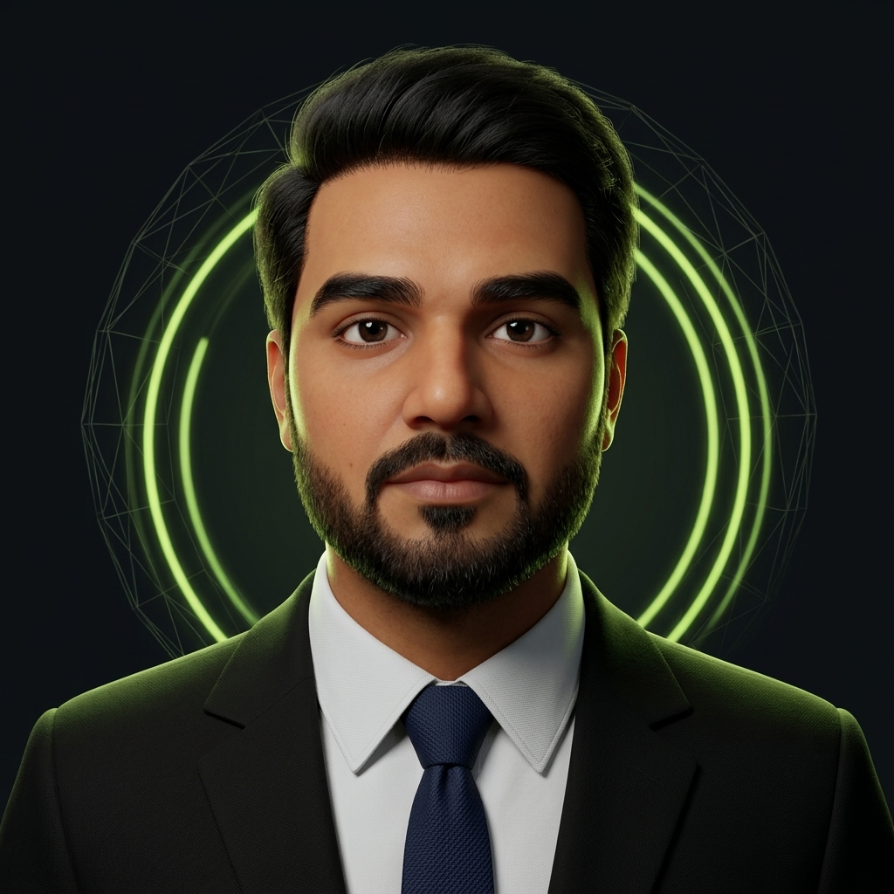

<!-- 3D EXECUTIVE PORTRAIT -->

 

<!-- HERO BANNER -->

### **IT Manager (Infrastructure, Systems & Digital Operations) at Enter and Post LLC**
*6+ Years Bridging Enterprise Networks, Endpoint Security, ERP/BI & Full-Stack AI Automation*

  
  

---

### `01.` Executive Summary

> **"From the patch panel to the P&L."**
> I direct complete enterprise IT functions—from physical Cisco networks, Active Directory, Symantec SEPM endpoint protection, and 3-2-1 hybrid backups (`EaseUS` + `Mega Cloud`) to building in-house Python OCR financial pipelines (`Statement Ops`), administering `Odoo ERP` + `Metabase BI`, and shipping **9+ live client production websites** optimized for SEO & AI Answer Engines (`AEO / GEO`).

| Metric | Impact Delivered |
| :--- | :--- |
| **`85%`** | Reduction in monthly accounting data-entry time via **Statement Ops** (in-house Python OCR & mathematical reconciliation engine) |
| **`9+`** | Live production client websites designed, deployed, and maintained across the US, South Africa & Pakistan |
| **`6+ Yrs`** | Hands-on enterprise IT leadership across banking (`Standard Chartered`, `Soneri Bank`), manufacturing (`Universal BrushWares`), and US financial ops (`Enter and Post LLC`) |

---

### `02.` Featured Engineering Case Study — **Statement Ops**

**Financial Extraction & Mathematical Reconciliation Engine (`Enter and Post LLC`)**
- **Problem**: Multi-page scanned bank statements and PDF invoices required hours of manual bookkeeping entry and row-by-row balance verification.
- **Architecture**: Built an in-house OCR extraction platform that parses PDF statements into structured transactions, runs automated mathematical reconciliation (`Opening Balance + Total Credits − Total Debits = Closing Balance`), flags row-level variances, and exports one-click **Excel (`.xlsx`)**, **CSV**, **PDF Summary**, and **QuickBooks-ready** batches.

---

### `03.` Live Production Web Architecture (`9 Client Deployments`)

| # | Project / Client | Live Domain | Focus & Deliverables |
| :-: | :--- | :--- | :--- |
| `01` | **Enter and Post LLC** | [enterandpost.com](https://enterandpost.com) | Website · Technical SEO · Off-Page SEO · Social Media |
| `02` | **TNT Commercial Services 615** | [tntcommercialservices615.com](https://tntcommercialservices615.com) | Website · On-Page SEO · Off-Page SEO · Social Media |
| `03` | **Janglee Painting LLC** | [jangleepainting.com](https://jangleepainting.com) | Website · On-Page SEO · Off-Page SEO · Social Media |
| `04` | **Natural Wonder Trees** | [naturalwondertrees.com](https://naturalwondertrees.com) | Website · On-Page SEO · Social Media Content |
| `05` | **Acewall Scholars** | [acewallscholars.org](https://acewallscholars.org) | Off-Page SEO · Social Media Content |
| `06` | **Duncan Brooke Accounting** | [duncanbrooke.co.za](https://duncanbrooke.co.za) | Website · On-Page SEO |
| `07` | **Piano Keys** | [pianokeys.org](https://pianokeys.org) | Website · On-Page SEO · Technical SEO |
| `08` | **Best Valuation (SECP & PBA)** | [bestvaluation.vercel.app](https://bestvaluation.vercel.app) | Next.js Web App · Valuation Certificate Engine |
| `09` | **GrowMore KSE-100 Terminal** | [growmore-ruddy.vercel.app](https://growmore-ruddy.vercel.app) | Institutional Stock Market Intelligence Terminal |

---

### `04.` Core Technical Stack

#### **Enterprise Infrastructure, Networking & Endpoint Security**

-080808?style=flat-square&logo=icloud&logoColor=C2F26B)

#### **ERP, Databases & Business Intelligence**
-080808?style=flat-square&logo=odoo&logoColor=C2F26B)

#### **Web Architecture, AI Automation & Search Growth (SEO / AEO / GEO)**

---

  Built with the <b>Signal</b> design system (`#080808` · `#C2F26B`) · <a href="https://szmughal.vercel.app">szmughal.vercel.app</a>

